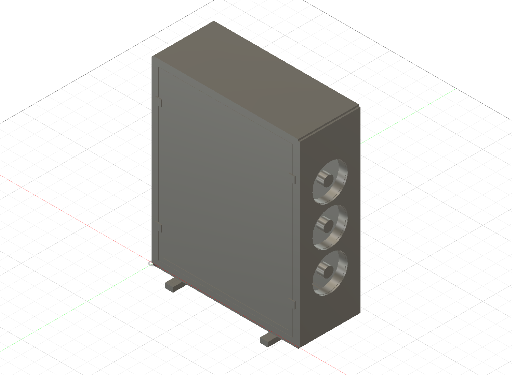

# Quiet DIY household air purifier

Research and preliminary design using 2020 aluminum extrusion, printed fittings, standard HVAC filters, and PC fans.

**Status: slim concept v0.2 — Fusion layout study, not a fabrication release.** No prototype has been built or measured.

The selected direction is a tall, slim six-fan cabinet with two nominal 20 × 25 inch filters. Develop one prototype, then evaluate two or more units for the user's approximately 600 ft² open floor plan connected to upstairs/downstairs hallways. At an assumed 8 ft ceiling, the 600 ft² alone needs 400 CFM for five equivalent clean-air changes/hour. Connected volume adds to this requirement.

- [Selected slim design, multi-unit sizing, budget and CAD files](docs/slim-v02.md)
- [How to identify the extrusion slot](docs/extrusion-identification.md)
- [Current chamfered M5 thin-nut fit samples for MK4S/MMU3](design/nut-fit-v02/README.md)
- [Earlier rectangular samples — failed physical fit](design/nut-fit-v01/README.md)

The user measured a 6.28 mm mouth, 11 mm internal cavity, 6.2 mm depth and approximately 5.7 mm floor width. Current v02 samples have sloped lower corners and require thin M5 nuts. Nut fit tests use the user's Prusa MK4S with MMU3, a selected 0.6 mm nozzle and Bambu PETG HF; the previously reported Bambu H2D remains available.

Printer: Bambu H2D. Intended per-unit target remains 200 CFM at ≤35 dBA at 1 m, measured at the same setting. This is a target, not achieved performance. Frame dimensions are 550 × 230 × 677 mm; stabilizers, panels and guard reservations increase the envelope to approximately 586 × 300 × 707 mm. Parts allowance: $220–380 per unit.

## Earlier v0.1 comparison baseline

Two opposing nominal 20 × 20 × 1 inch MERV 13 filters feed a sealed cabinet with six 140 mm PWM fans exhausting upward. Extrusion provides the structure; small printed parts retain filters and cover corners. Flat sheet panels keep printing and assembly manageable.

For a provisional 300 ft² room with an 8 ft ceiling, target **200 CFM particle CADR at no more than 35 dBA at 1 m**, with a stretch target of 30 dBA. These are simultaneous design goals, not predicted or measured performance. A quieter sleep setting may serve a smaller room.

- [Research and source comparisons](docs/research.md)

- [Concept, sizing, assembly, and preliminary parts budget](docs/concept.md)

- [Prototype validation and next decisions](docs/validation.md)

- [Concept drawing](design/concept.svg)

The earlier 300 ft² room assumption below the v0.1 heading is retained as historical context. Current requirements are in the slim design brief. Ceiling height, connected volume, budget ceiling, pollutant priorities, actual filters, and extrusion slot profile still need confirmation. Research checked 2026-10-27.
