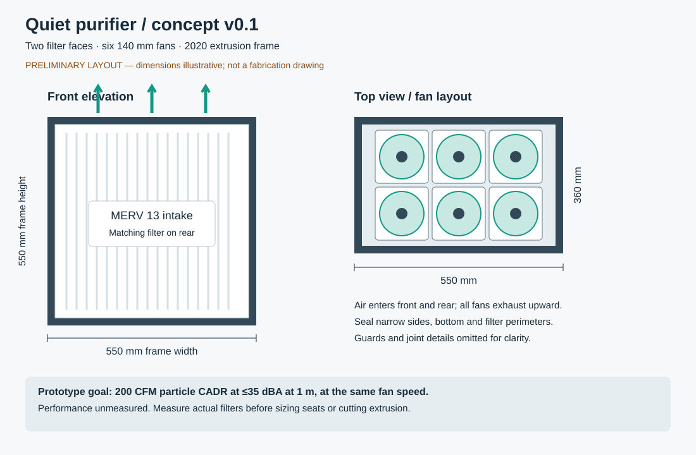

# Quiet DIY household air purifier

Research and preliminary design using 2020 aluminum extrusion, printed fittings, standard HVAC filters, and PC fans.

**Status: concept v0.1 — not a fabrication release.** Dimensions, budget, and performance targets are provisional. No prototype has been built or measured.

## Starting point

Two opposing nominal 20 × 20 × 1 inch MERV 13 filters feed a sealed cabinet with six 140 mm PWM fans exhausting upward. Extrusion provides the structure; small printed parts retain filters and cover corners. Flat sheet panels keep printing and assembly manageable.

For a provisional 300 ft² room with an 8 ft ceiling, target **200 CFM particle CADR at no more than 35 dBA at 1 m**, with a stretch target of 30 dBA. These are simultaneous design goals, not predicted or measured performance. A quieter sleep setting may serve a smaller room.

- [Research and source comparisons](docs/research.md)

- [Concept, sizing, assembly, and preliminary parts budget](docs/concept.md)

- [Prototype validation and next decisions](docs/validation.md)

- [Concept drawing](design/concept.svg)

Room size, budget, allowable footprint, pollutant priorities, printer size, and extrusion slot profile still need confirmation. Research checked 2026-10-27.
