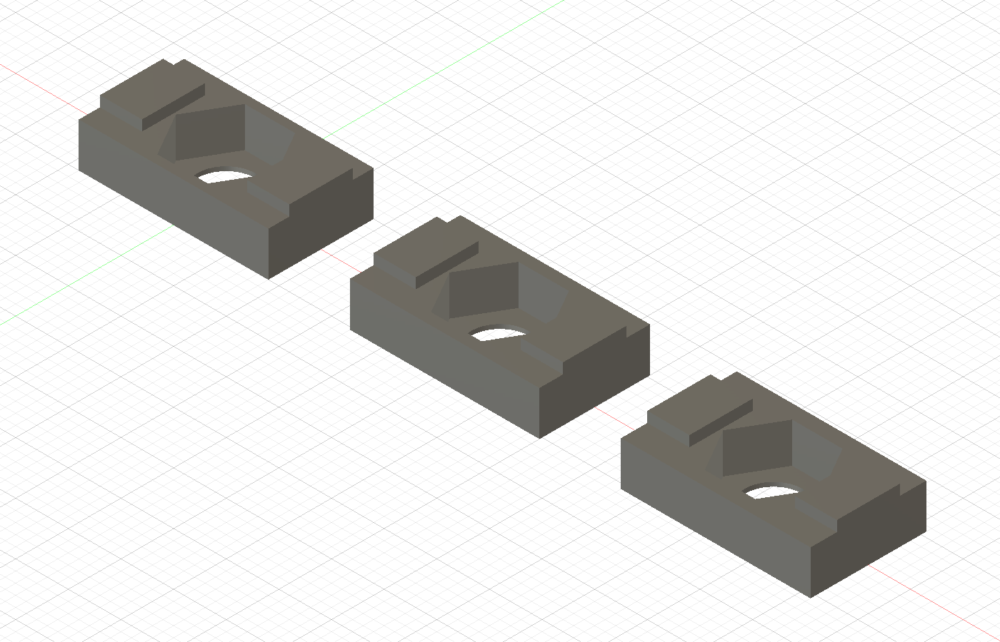

# M5 nut-carrier fit samples v0.1

Designed 2026-10-27 for the user's photo and approximately **6.28 mm measured slot mouth**. These are end-loading fit samples requiring a metal M5 nut; they are not validated structural T-nuts.

## Print files

- [PrusaSlicer project](fit-samples_MK4S-MMU3_0p4_PETG.3mf)
- [G-code](fit-samples_MK4S-MMU3_0p4_PETG.gcode)
- [Three-part STL](three-carriers.stl), plus individual numbered STLs
- [Fusion archive](nut-fit-v01.f3d), [STEP](nut-fit-v01.step), [generator](generate_fusion.py)

Sliced using installed PrusaSlicer 2.9.6: **Original Prusa MK4S MMU3 0.4 nozzle** (standard/non-high-flow), Generic PETG, 0.20 mm STRUCTURAL, four perimeters, 100% rectilinear infill, no supports, no wipe tower. All parts use **MMU slot 1 / T0**. Estimated normal time: 12m33s; total filament 2.49 g including startup extrusion.

Check the installed nozzle: this uses the standard 0.4 mm preset, not HF0.4 or 0.6 mm. The user confirmed MK4S/MMU3 and PETG, but did not specify nozzle flow type or PETG brand. Reslice if those differ. Generic PETG uses 240°C nozzle, 85°C first-layer bed and 90°C subsequent bed; use the filament maker's settings if different. Use a PETG-compatible build surface and its preparation/release instructions.

Files were generated locally. Nothing has been uploaded to a printer or physically printed.

## Fit geometry

One, two or three shallow dots underneath identify **10.0, 10.5 and 11.0 mm body widths**, respectively. Each is 18 mm long, with a 4.2 mm body and 5.2 mm overall height including guide tabs. Guide width is 6.0 mm, giving 0.28 mm total nominal clearance at the measured mouth.

The open-top hex pocket is 8.3 mm across flats and 3.8 mm deep, with a 0.4 mm retaining floor and 5.5 mm screw clearance hole. Guides at the ends avoid a thin printed neck around the screw.

Use a plain metal **M5 × 0.8 hex nut**, nominally 8 mm across flats and 4 mm thick ([dimensioned example](https://www.accu.co.uk/hexagon-nuts/456462-HPN-M5-C8)). Measure yours: thickness varies. A 4 mm nut sits 0.2 mm proud of the carrier shoulder, intended to bear on the underside of the aluminum lips before the plastic shoulder carries clamp load. If the nut is recessed, tilted or too thin, adjust the pocket before joint testing.

## Test sequence

1. Print at 100% scale, floor on the bed and pocket facing upward, as supplied.
2. Remove strings and any first-layer edge flare after cooling. Seat a nut by hand; do not force it. The pocket locates the nut but is not a snap-fit.
3. Start with the one-dot sample. Hold its nut while sliding it into an accessible cut end of the extrusion. The guide tabs enter the mouth; the wider body sits behind the lips. It is not a drop-in nut.
4. Try wider samples if they slide freely. If all bind, identify whether the guide width, cavity width, sloped cavity walls or depth interferes. The photo shows a shaped cavity, so rectangular samples may need chamfers or reduced height.
5. Check that the metal nut contacts both lips and the guide tabs remain below the extrusion's outer face. The bracket must seat on aluminum, not on plastic.
6. For a light bench fit check, use a screw with adequate nut engagement that does not bottom in the extrusion. Hand-snug only; no torque rating is established.

Report which dot count fits, whether the nut seats and whether the guides protrude. Use commercial metal T-nuts for the purifier's structural frame until fit and load path are validated.

## Verification

Fusion created three solid bodies. PrusaSlicer reports the final combined STL as manifold with three parts; final dimensions are 70 × 11 × 5.2 mm for the arranged set. The revised open-top pocket sliced without the original unsupported-extrusion warning. G-code checks confirmed MK4S, MMU3, 0.4 mm nozzle, PETG, T0 and requested settings. Physical fit and strength remain untested.

## Prusa integration

No dedicated PrusaSlicer plugin was found in the available directory. No official Prusa MCP server was located in the official sources checked on 2026-10-27.

- [PrusaSlicer](https://github.com/prusa3d/PrusaSlicer) supplies the command-line interface already used here. No extra extension is needed for local profile selection, slicing and 3MF export.
- [PrusaLink and Prusa Connect](https://www.prusa3d.com/p/prusa-connect/) provide local and cloud printer management; useful for future file transfer and status.
- [Official PrusaLink API specification](https://github.com/prusa3d/Prusa-Link-Web/blob/master/spec/openapi.yaml) documents an integration path; capabilities depend on firmware.

No extensions were installed. No connection credentials were read or saved.
