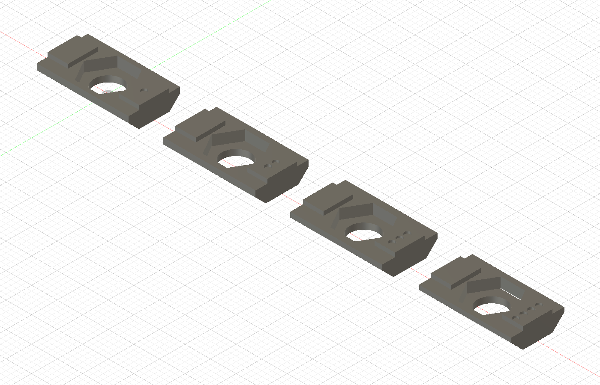
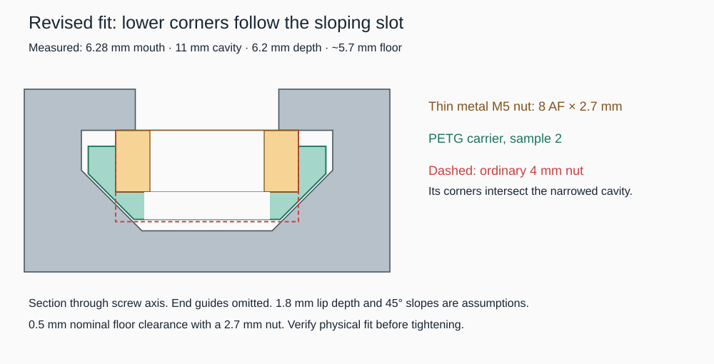

# Chamfered M5 thin-nut carriers — v02

The v01 rectangular carriers failed the physical fit test. This revision removes the lower corners to follow the cavity's sloping walls. These are end-loading fit samples, not load-rated structural fasteners.

## Measurement and likely profile

User caliper measurements: opening **6.28 mm**, widest internal cavity **11 mm**, outer-face-to-floor depth **6.2 mm**, floor width **approximately 5.7 mm** (least certain). The existing oblique photo shows conventional lips and inner slopes; it is not suitable for precision photogrammetry. These caliper values supersede earlier image estimates.

Closest published comparison: **Wellste W-6-2020**, a conventional 20 × 20 mm nominal slot-6 T-slot profile, with **6.2 mm mouth, 11 mm cavity, 6.1 mm depth** and sloping inner corners. See page 3 of the [manufacturer drawing](https://www.wellste.com/wp-content/uploads/2021/05/2020-aluminum-extrusion_Catalog.pdf). This identifies a likely geometry family, not a proven brand or universally interchangeable standard.

Other comparisons:

- [MISUMI HFS5-2020](https://sg.misumi-ec.com/pdf/fa/2013/p1839.pdf) has a 6 mm opening but a **12 mm** cavity, making it a poorer match to the measured 11 mm cavity.
- [Bitfab 2020V drawing](https://bitfab.parts/wp-content/uploads/2023/11/2020V-20x20mm-V-Slot-Profile-Drawing-v2.pdf) gives a 6.25 mm mouth and similar inner cavity but has pronounced outer 90-degree V-wheel running faces absent from the supplied photo. A sloping internal cavity alone does not make a profile V-slot.

The **45-degree slopes and 1.8 mm lip depth remain inferred**, not measured. For a 5.7 mm floor and 11 mm cavity, the 45-degree transition extends 2.65 mm in depth. The samples account for this rather than assuming a rectangular channel. Local source PDFs and rendered pages are in `references/`.

## Four samples

Identify samples by 1–4 recessed dots on one end guide. Dimensions in mm:

| Dots | Maximum width | 45° corner relief, each side | Bottom width |
|---|---:|---:|---:|
| 1 | 10.0 | 2.0 × 2.0 | 6.0 |
| 2 | 10.4 | 2.0 × 2.0 | 6.4 |
| 3 | 10.8 | 2.2 × 2.2 | 6.4 |
| 4 | 10.4 | 2.3 × 2.3 | 5.8 |

All are 18 mm long, body height 3.2 mm, guide width 5.8 mm and guide height 0.8 mm (overall 4.0 mm). The guide fits the 6.28 mm mouth with 0.48 mm nominal total clearance. No drop-in rotation is intended.

Nut pocket: 8.3 mm across flats, 2.0 mm deep over a 1.2 mm floor; screw clearance 5.5 mm. **Use M5 × 0.8 thin metal hex nuts, nominal 8 mm AF × 2.7 mm thick (DIN 439 / ISO 4035), not ordinary 4 mm-high nuts.** [Supplier dimensional reference](https://www.pts-uk.com/products/nuts/hexagon-thin-nuts/metric-a2/a43905) lists thickness 2.45–2.70 mm. Measure actual nuts. A nominal nut stands 0.7 mm proud of the carrier shoulder, permitting metal contact with the extrusion lips. Sample 4 deliberately has extra relief and small pocket-side openings near the pocket floor; it is the clearance fallback, not a strength improvement.

With a nominal 2.7 mm nut and inferred 1.8 mm lip depth, the carrier bottom is 5.7 mm below the outer face, leaving 0.5 mm depth clearance. The model checks minimum total width clearances of 0.7 / 0.3 / 0.2 / 0.6 mm for samples 1–4. These checks depend on the assumed slope/lip geometry and do not guarantee physical fit. Thinner nuts move the carrier deeper when seated, reducing clearance. An ordinary 4 mm nut extends into the narrowed cavity and is unsuitable.

## Print and test

- [Configured PrusaSlicer project](fit-v02_MK4S-MMU3_0p6_PETG-HF.3mf)
- [G-code](fit-v02_MK4S-MMU3_0p6_PETG-HF.gcode)
- [Combined STL](four-carriers.stl), [Fusion archive](nut-fit-v02.f3d), [STEP](nut-fit-v02.step), [generator](generate_fusion.py)

MK4S + MMU3, standard 0.6 mm nozzle, Bambu PETG HF, slot 1 / T0, 0.20 mm layers, 240°C nozzle / 75°C bed, four perimeters, 100% infill, no supports or wipe tower. Print pocket-up as supplied. Estimate **9m24s, 2.26 g**. Thin pocket walls are intentional in these fit samples.

After cooling, remove strings/first-layer flare. Slide sample 1 into an accessible cut end, chamfered narrow face toward the central web and guides toward the opening. Test 2/3 next; try 4 if inner-corner interference remains. First test without hardware, holding the shoulder against the lips so it does not wedge against the floor. Then repeat with a measured thin nut and a screw, hand snug only. Check free sliding and metal-to-metal seating. Record dot count, whether it fits without/with the nut, actual nut thickness, and any contact marks. Do not force a jammed sample.

## Verification and print status

Fusion reports four solid bodies. PrusaSlicer reports four manifold parts, combined arrangement 93 × 10.8 × 4 mm. CLI slicing and the packaged 3MF round-trip slice succeeded with no support warnings. G-code checks confirm MK4S/MMU3, 0.6 mm nozzle, only T0, 240/75°C. `package_and_check.py` embeds configuration and verifies the assumed cross-section envelope. Physical fit and clamping strength remain unverified.

Print initiation attempted through PrusaSlicer Connect, but the automation tool rejected interaction with the embedded WebView (process mismatch). No v02 start command was confirmed. User selected local PrusaLink setup as the next route. The revised project is loaded and its Connect scheduling dialog is open. Do not interpret file creation as a started print.
